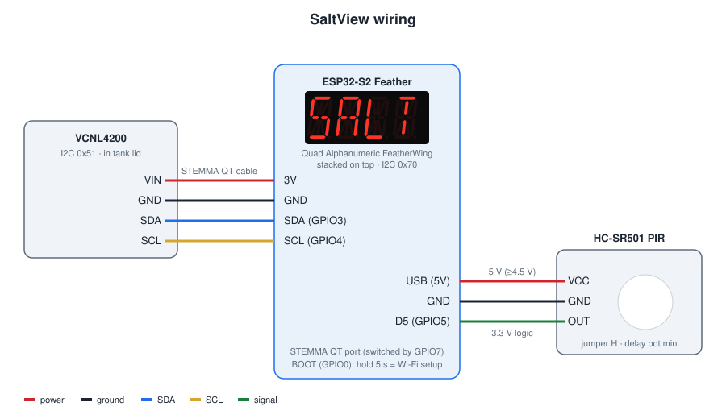

# Wiring



## Parts

| Part | Interface | Notes |
|---|---|---|
| Adafruit ESP32-S2 Feather (4 MB flash, 2 MB PSRAM) | — | Core board, native USB |
| Adafruit Quad Alphanumeric FeatherWing (14-seg, HT16K33) | I2C `0x70` | Stacks on the Feather |
| Adafruit VCNL4200 long-distance proximity sensor | I2C `0x51` | STEMMA QT cable |
| HC-SR501 PIR motion sensor | Digital out | Needs 4.5–20 V supply |
| STEMMA QT / Qwiic cable (≥ 200 mm) | — | Sensor sits in the tank lid |
| Feather stacking headers | — | So you can still reach the pins |
| 5 V USB power supply | — | Powers the Feather **and** the PIR |

## Pin-to-pin

### Quad Alphanumeric FeatherWing → ESP32-S2 Feather

Stacks directly; only these pins are used.

| FeatherWing pin | Feather pin | GPIO | Function |
|---|---|---|---|
| 3V | 3V | — | Logic + LED power |
| GND | GND | — | Ground |
| SDA | SDA | GPIO3 | I2C data |
| SCL | SCL | GPIO4 | I2C clock |

Leave the address jumpers (A0–A2) open → `0x70`.

### VCNL4200 → ESP32-S2 Feather (STEMMA QT)

Plug a STEMMA QT cable into the Feather's STEMMA QT port. If you hand-wire instead:

| VCNL4200 pin | Wire colour (STEMMA QT) | Feather pin | GPIO |
|---|---|---|---|
| VIN | Red | 3V | — |
| GND | Black | GND | — |
| SDA | Blue | SDA | GPIO3 |
| SCL | Yellow | SCL | GPIO4 |
| INT | — | not connected | — |

The Feather's STEMMA QT port is switched by `PIN_I2C_POWER` (GPIO7); the firmware turns it on at boot.

### HC-SR501 PIR → ESP32-S2 Feather

| HC-SR501 pin | Feather pin | GPIO | Notes |
|---|---|---|---|
| VCC | USB | — | 5 V from the USB jack. The PIR's regulator needs ≥ 4.5 V, so **3V will not work** |
| OUT | D5 | GPIO5 | 3.3 V logic high on motion — safe for the ESP32-S2. RTC-capable, so it can wake from deep sleep |
| GND | GND | — | |

Solder the PIR wires to the matching through-holes on top of the FeatherWing (stacking headers pass every Feather pin through).

HC-SR501 settings:

- **Trigger jumper → H** (repeat trigger), so continued movement keeps the output high.
- **Time-delay pot → fully counter-clockwise** (~3 s). The firmware decides how long the display stays on.
- **Sensitivity pot** → mid; turn down if it triggers from across the room.
- The PIR needs ~30–60 s to settle after power-up; the firmware ignores it for the first 30 s.

### Free / reserved pins

| Feather pin | GPIO | Use |
|---|---|---|
| BOOT button | GPIO0 | Press: wake display. Hold 5 s: forget Wi-Fi, reboot into setup mode |
| D13 | GPIO13 | Red LED (unused) |
| NeoPixel | GPIO33 | Unused |
| A0–A5, D6, D9–D12 | — | Free for expansion (e.g. a second sensor) |

## Power

- **Always-on mode (default):** run from a 5 V USB adapter. This powers the Feather, and the USB pin feeds the PIR.
- **Deep-sleep mode:** the ESP32 sleeps between readings and wakes on PIR motion (GPIO5) or the log timer.
  On LiPo-only power the USB pin is dead, so the PIR needs its own ≥ 4.5 V source
  (or the common HC-SR501 3.3 V mod that bypasses its regulator). The I2C rail switches off during
  deep sleep, so the VCNL4200 draws nothing.

## Mounting in the brine tank

```
            lid
   ┌──────────────────────────┐
   │   [VCNL4200]  ↓ IR       │   sensor face pointing straight down,
   │      │                   │   away from the brine well and tank walls
   │      │  distance         │
   │      ▼                   │  ── "Full" mark (sensor → salt when full)
   │   ░░░░░░░░░░░░░░░        │
   │   ░░░░ salt ░░░░░        │
   │   ░░░░░░░░░░░░░░░        │  ── "Empty" mark (sensor → grid plate / floor)
   │  ~~~~~ brine ~~~~~       │
   └──────────────────────────┘
```

- The VCNL4200's usable range is roughly 0–1.5 m; most brine tanks are 0.6–1.0 m deep, which works,
  but the far end needs calibration points down there.
- Mount the sensor bare or behind an IR-transparent window. A window reflects some IR back —
  capture a **baseline** on the Setup page to cancel it.
- Brine tanks are humid and salty. Keep the Feather and display outside the tank; only the sensor
  board goes inside, ideally with a conformal coat on everything except the sensor window.
